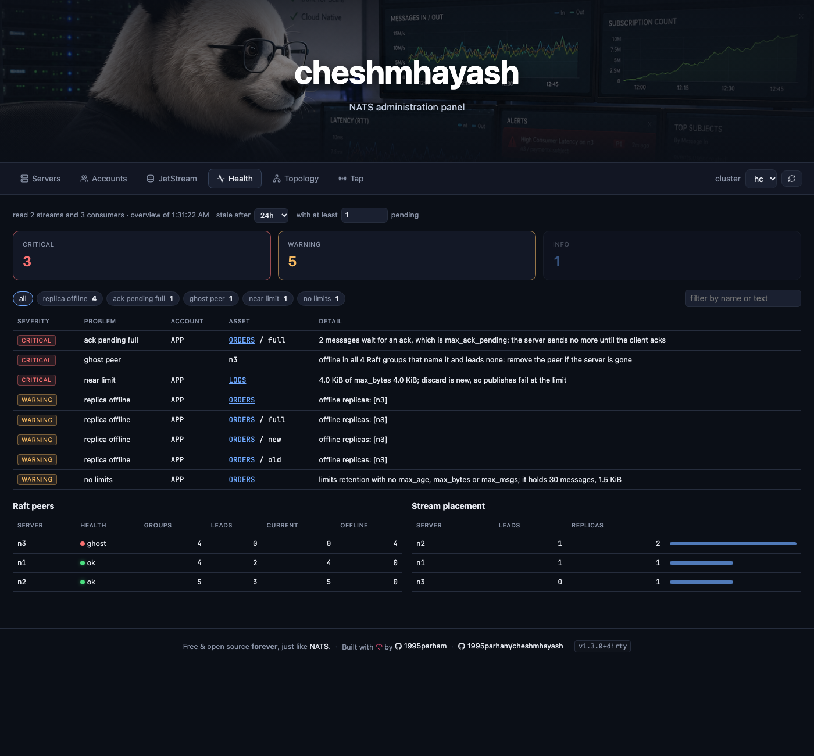

The Health tab answers one question: what in this cluster needs attention? It reads the overview that the dashboard already caches, so it adds no NATS traffic. It uses the same rules as the `consumer scan`, `peer check` and `stream report` commands.

[Open the Health tab in the demo](/cheshmhayash/demo/#health).

## Findings

| Severity | Finding | Why it matters |
| --- | --- | --- |
| critical | ack pending full | A consumer reached `max_ack_pending`. The server delivers nothing more until the client acks. |
| critical | near limit, discard new | A stream is above 90% of `max_bytes` or `max_msgs` with `discard: new`. Publishes fail at the limit. |
| critical | no leader | A stream or consumer Raft group has no leader. Reads and writes stop. |
| critical | ghost peer | A server is offline in every Raft group that names it and leads none: a removed server that was never peer-removed. |
| warning | stale consumer | Messages wait and nobody acked for longer than "stale after" (24 hours by default). |
| warning | no limits | A limits stream with no `max_age`, `max_bytes` or `max_msgs`. It grows until the disk is full. |
| warning | replica offline | A replica of a group is offline. The group keeps quorum while most replicas run. |
| warning | replica lagging | A replica is online but behind the leader. |
| warning | lagging peer | A server that Raft groups name but that is current in none of them. |
| info | one replica | A stream with one replica. It is unavailable while its server is down. |
| info | near limit, discard old | A stream near a limit with `discard: old`. Old messages go first, which may be what you want. |

A consumer that was never acked is not stale while it is younger than "stale after", so a new consumer does not show up at once.

## Using the tab

- Click a severity card to show or hide that severity. Critical and warning are on at first.
- Click a kind chip to show one kind. Hover a chip for an explanation.
- Type in the search box to filter by account, stream, consumer, peer or text.
- Change **stale after** and **with at least N pending** to tune the stale-consumer rule.
- Click a stream name to open the stream detail.

Two hints come with stale consumers:

- **renamed to**: another consumer on the same stream filters the same subject and is active. The stale one is likely the old name of a rename.
- **managed**: NACK, Terraform or a GitOps pipeline owns the consumer. cheshmhayash never deletes it. See [protect rules](/cheshmhayash/cli/consumer/#protected-consumers).

Below the findings are two tables: each Raft peer's standing (OK, LAGGING or GHOST, with groups, leads, current and offline counts), and the stream placement per server, so you can see skew.

## Cleanup

The Health tab only shows findings. To remove stale consumers, use [`consumer scan` and `consumer apply`](/cheshmhayash/cli/consumer/), or the [bot](/cheshmhayash/guides/bot/).

The same report is available as `GET /api/jsm/clusters/{c}/health?min_idle=24h&min_pending=1` and as the MCP tool `jetstream_health`.
