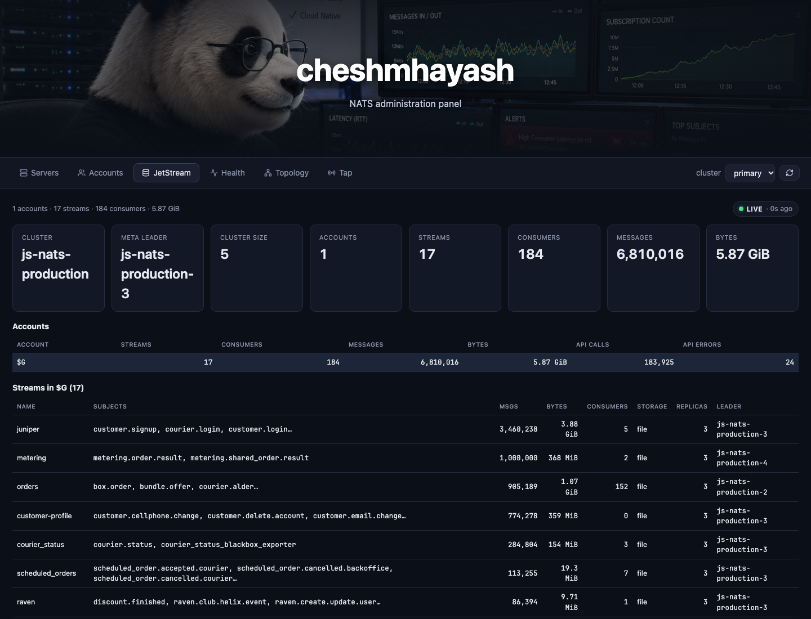

The JetStream tab shows the whole cluster in one view. It is built from one `$SYS.REQ.SERVER.PING.JSZ` fan-out: every server sends its part, and the panel merges them. Each stream and each consumer comes from the reply of its own Raft leader, because only the leader knows the state of every replica.

[Open the JetStream tab in the demo](/cheshmhayash/demo/#jetstream).

## What it shows

- **Totals**: the meta leader, the cluster size, and the number of accounts, streams, consumers, messages and bytes.
- **Accounts**: one row per account with its streams, consumers and storage.
- **Streams**: one row per stream with its subjects, replicas, messages, bytes and consumers.

## Stream detail

Click a stream to open it. The panel shows its config, its state, its replicas and its consumers. An admin can:

| Action | What it does |
| --- | --- |
| Edit | Opens the stream config in a JSON editor (CodeMirror) and sends the whole `StreamConfig` back. |
| Step down | Forces the stream's Raft group to elect a new leader. |
| Purge | Removes every message. The config and the consumers stay. |
| Delete | Removes the stream. This cannot be undone. |
| Consumer step down | Forces a consumer's Raft group to elect a new leader. |

The Topology tab has the matching action for the meta group: meta step down.
