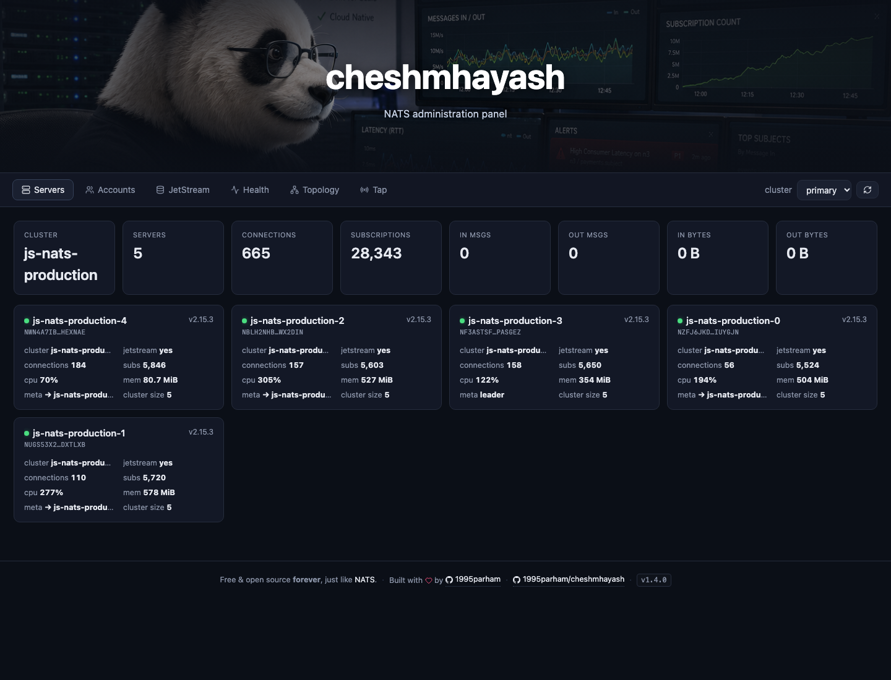

The Servers tab finds every server of the cluster with `$SYS.REQ.SERVER.PING`. It shows the cluster totals at the top: servers, connections, subscriptions, and messages and bytes in and out. Below them is one card per server, with its name, ID, version and a badge on the JetStream meta leader.

[Open the Servers tab in the demo](/cheshmhayash/demo/#servers).

## Server detail

Click a card to open the server. Its sub-tabs show the raw replies of the monitoring endpoints, as the server sends them: `VARZ`, `CONNZ`, `SUBSZ`, `JSZ`, `ROUTEZ`, `GATEWAYZ`, `LEAFZ`, `HEALTHZ` and `ACCOUNTZ`. They are the same JSON that the HTTP monitoring port gives, but they come over the NATS connection.

## Actions

An admin sees three actions on a server:

| Action | What it does |
| --- | --- |
| Reload | Reloads the server's configuration file (`$SYS.REQ.SERVER.<id>.RELOAD`). |
| Lame duck | Puts the server in lame-duck mode: it stops taking new clients and drains the ones it has. |
| Kick | Disconnects one client by its connection ID (CID). |
