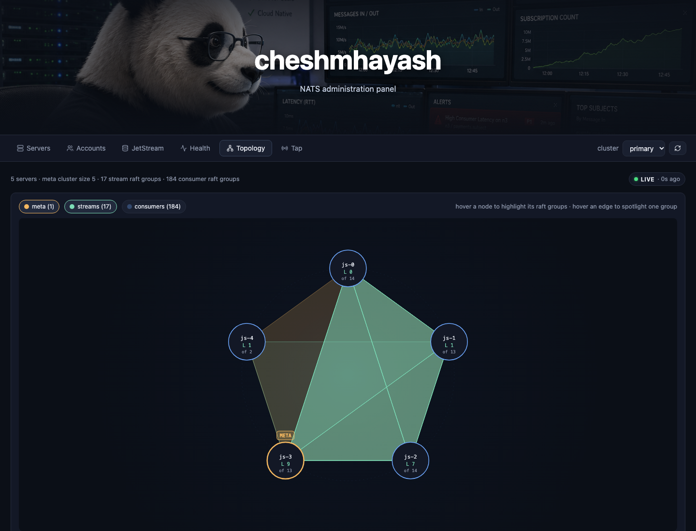

The Topology tab shows how the JetStream Raft groups sit on the servers. Each group is a polygon that connects its replicas: the meta group in amber, streams in green and consumers in blue.

[Open the Topology tab in the demo](/cheshmhayash/demo/#topology).

## What it shows

- **The graph**: servers and the Raft groups that join them.
- **Distribution per server**: how many stream and consumer groups each server leads and follows, and which server is the meta leader. Use it to find a server that leads too much.
- **The group matrix**: one row per Raft group and one column per server. `L` is the leader, `F` a follower, and `·` a follower that is not current.

## Actions

An admin can force a **meta step down**: the JetStream meta group elects a new leader. Step down for one stream or consumer is in the [JetStream tab](/cheshmhayash/dashboard/jetstream/).
